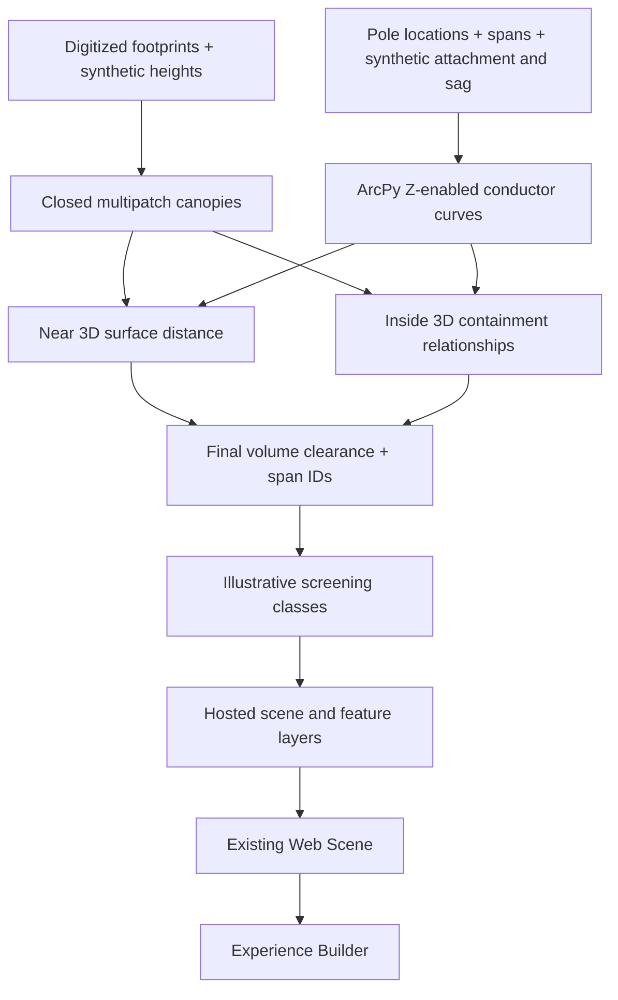

# 3D Vegetation Clearance Screening

**Status: core analysis and public Web MVP completed.** Documentation closeout: 2026-10-20.

**[Live application](https://experience.arcgis.com/experience/af7532559e924046aec35b94c8e090f1/)** · **[Web Scene](https://www.arcgis.com/apps/sceneviewer/index.html?webscene=ec1b41378db342698ce06f8b229e1836)** · **[Scene item and attribution](https://www.arcgis.com/home/item.html?id=ec1b41378db342698ce06f8b229e1836)**

## Problem and scope

How can a GIS workflow identify simulated vegetation volumes approaching or intersecting conductors, and communicate results through an interactive 3D application?

This independent portfolio project models **241 imagery-digitized canopy footprints** as closed extruded volumes and **73 conductor spans** as sampled parabolic curves. Dimensions and infrastructure parameters are synthetic; this is not measured utility or vegetation data.

## Architecture



## Modeling and analysis

- Working XY: **NAD83 / Alberta 3TM ref merid 114 W, EPSG:3776**, metres.
- Ground: **synthetic 1000 m**, not surveyed Calgary elevation or a vertical datum.
- Tree heights: 6/9/12/15 m; crown bases: 2/3/4 m above synthetic ground.
- Crown base Z = ground + crown-base height; extrusion depth = tree height − crown-base height.
- Layer 3D To Feature Class generated multipatches. Is Closed 3D detected open geometry; Enclose Multipatch generated closed outputs. Business attributes were restored by joining `OID_ORIG` to the immediate input's `OBJECTID`.
- Pole attachment heights are 12 m; sag is 1 m. The curve is a simplified parabola, not an engineering catenary.

For `0 ≤ t ≤ 1`:

```text
X(t) = (1−t)X0 + tX1
Y(t) = (1−t)Y0 + tY1
Z(t) = (1−t)Z0 + tZ1 − 4 × sag × t × (1−t)
```

Endpoints and the midpoint are retained. Final planar sampling intervals do not exceed 0.25 m.

**Near 3D alone is insufficient:** a fully contained test line returned 4 m to the cube surface instead of zero volume clearance. Inside 3D therefore runs with lines as targets and closed canopies as containers. Any canopy with a partial/full internal relationship receives zero final clearance; otherwise valid `NEAR_DIST3` supplies the distance. Raw Near fields remain separate.

`nearest_span_id` is the nearest span for separated objects. Multiple internally intersecting/contained spans all have zero clearance; a lexically sorted representative is stored, and all related IDs remain in `inside_span_ids`. Comparisons use stable `veg_id`; relationship-table OBJECTIDs refer only to their exact tool inputs.

## Results

| Metric | Count |
|---|---:|
| Canopies / conductor spans | 241 / 73 |
| High: clearance <2 m | 67 |
| Medium: 2 m ≤ clearance <4 m | 62 |
| Low: clearance ≥4 m | 112 |
| Unknown | 0 |
| Zero clearance, included in High | 52 |
| Inside 3D relationships / distinct internal canopies | 21 / 16 |

[Validation](validation.md) documents known geometry cases and sensitivity to 0.5 m versus 0.25 m sampling. The maximum change was **0.000134 m**, with **zero class changes**. Figures come from operator-run Pro outputs and screenshots in the project session, not a fresh closeout recomputation.

## Online presentation

The public app provides classified canopies, conductor spans, and English attribute pop-ups. The initial release passed operator incognito tests. At closeout, anonymous REST checks independently confirmed the public app/scene, accessible final layers (241 canopies and 73 spans), 67/62/112 class counts, 52 zero-clearance canopies, and 0.25 m conductor sampling. Scene description and terms were present. A complete final browser/mobile visual audit was not performed.

The publishing scene uses EPSG:3857 and Light Gray Canvas without real terrain. Both layers receive a **−1000 m Scene Viewer display offset**, aligning synthetic ground to zero while leaving analysis geometry unchanged. Pro's canopy publishing analyzer rejected its cartographic offset, so it was published with zero offset and configured online afterward.

New layers were added to the existing scene to preserve the application URL. Static Experience Builder text was updated and the app republished separately. The Web Scene description and terms were restored after revision.

## Documentation

- [Actual data model](data-model.md)
- [Data sources and attribution](source-register.md)
- [Implementation and publishing checklist](implementation-plan.md)
- [Validation evidence](validation.md) / [JSON summary](results/validation-summary.json)
- [Script archive and execution notes](scripts/README.md)
- [Retrospective](retrospective.md)
- [Resume-ready project entry](resume-project.md)

The local `arcgis/` directory is ignored. **No ArcGIS folder backup was made at closeout.** Cloning the repository does not supply the working GDB/APRX. Scripts require locally supplied prepared data and a licensed Pro environment.

## Limits and future work

Canopies are simplified prisms, with synthetic heights and no measured vertical reference. Enclosure may alter geometry; closure and Z checks do not establish physical accuracy. The sensitivity comparison measures conductor discretization stability only. Thresholds are illustrative, **not electrical clearance standards**.

Field Maps/Survey123, inspection/QC lifecycles, dashboards, LiDAR/terrain integration, and engineering conductor models are not implemented. A full mobile-layout/accessibility review, walkthrough video, and final anonymous editing-permission audit are not claimed as completed.
